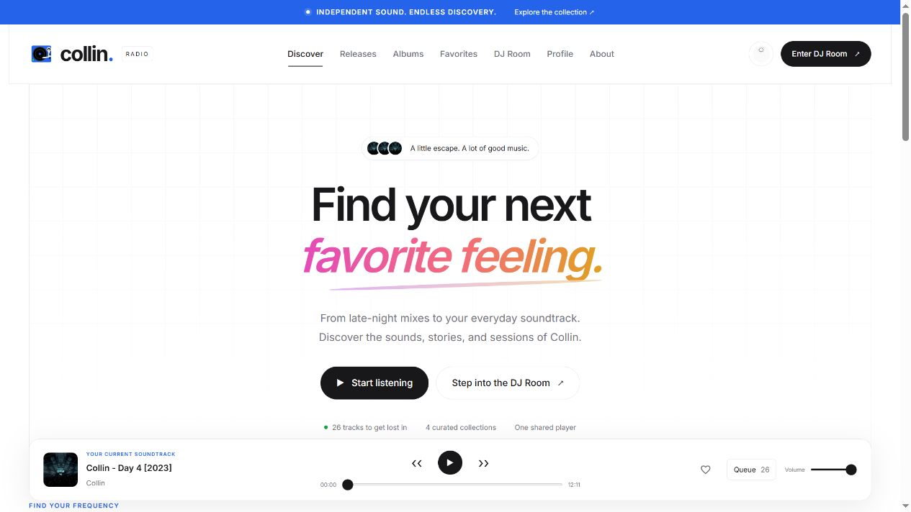
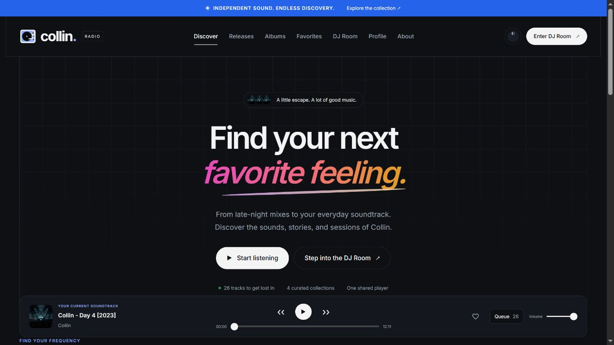
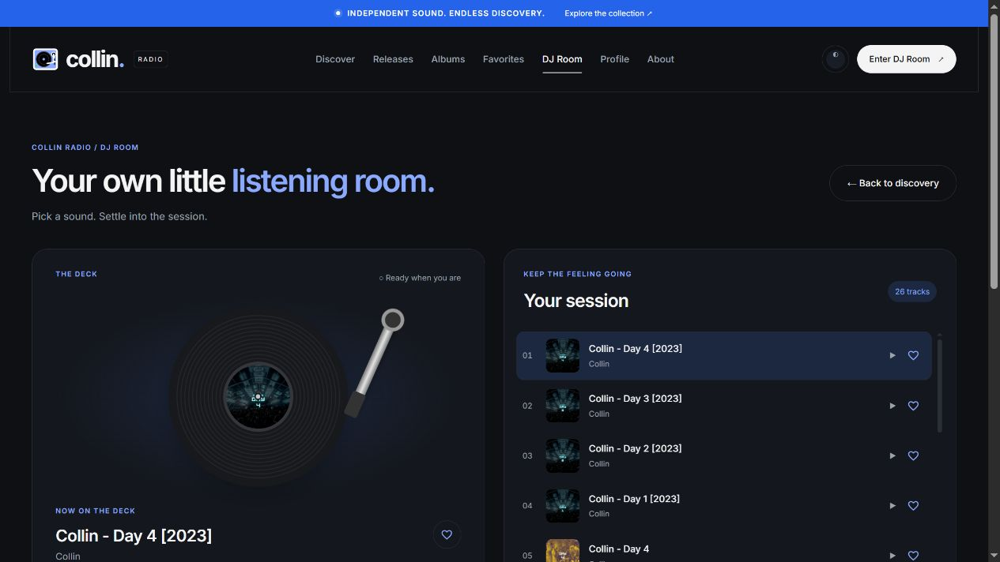
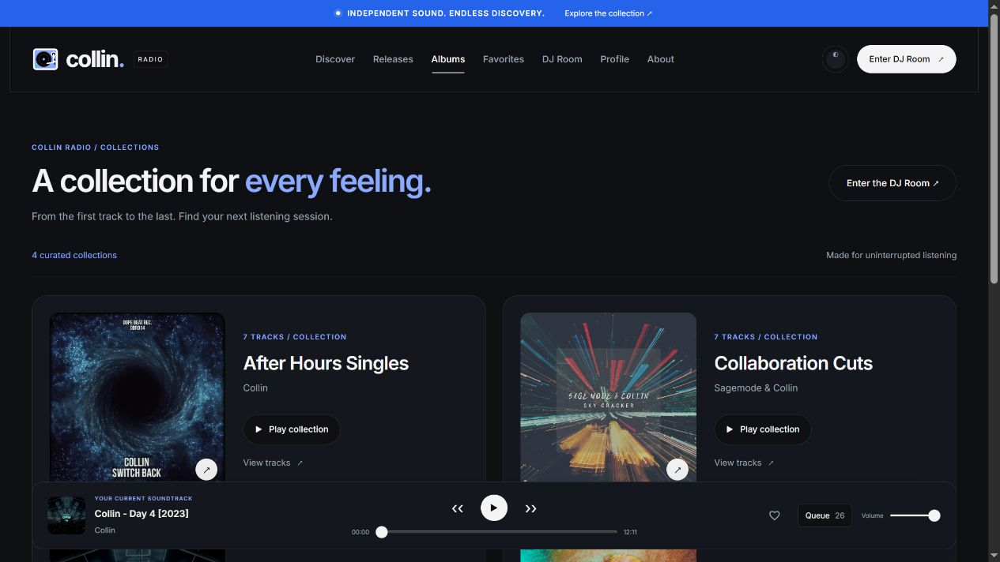
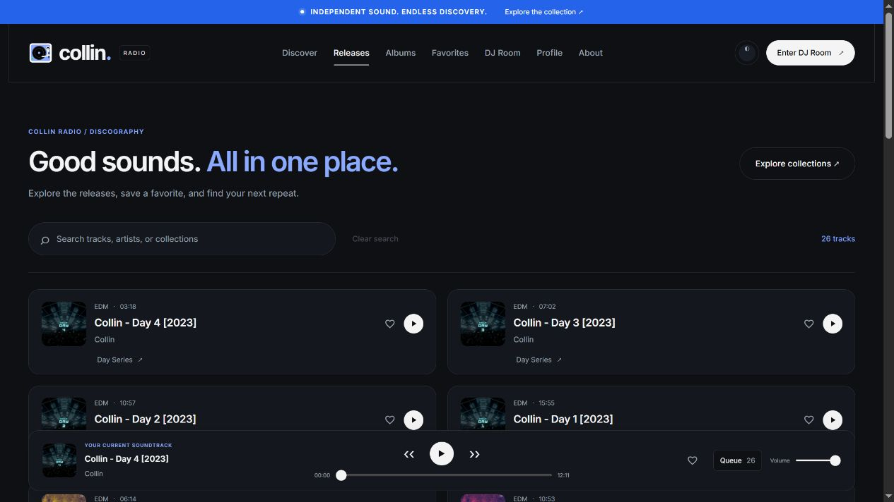
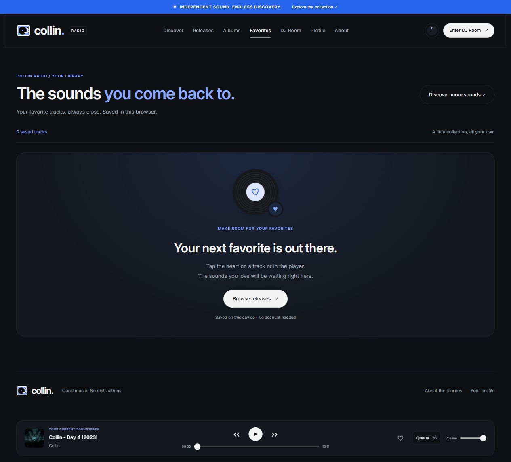

# Melodic Journeys of Collin

A Blazor WebAssembly music library with a persistent player and a dedicated DJ Room.

<p align="center">
  
</p>

Live app: [burma-collin.vercel.app](https://burma-collin.vercel.app/)

## Design

The interface adapts the visual language of [PrebuiltUI](https://prebuiltui.com/): a subtle grid, generous whitespace, bold Inter typography, pill buttons, thin borders, and a pink-to-gold headline. Album artwork and a floating player keep the experience focused on music.

- Responsive desktop navigation and mobile menu.
- Light, dark, and system themes.
- Search across tracks, artists, genres, and collections.
- Persistent playback, queue selection, seeking, volume, and saved favorites.
- Shared styling across releases, albums, favorites, profile, and DJ Room.

## Screenshots

Captured from the [live app](https://burma-collin.vercel.app/).

### Light theme



### Dark theme



### DJ Room

A dedicated turntable, playback controls, readable session queue, and collection shortcuts.



### Albums

Collections use the DJ Room typography, artwork cards, and direct playback controls.



### Releases

Searchable track cards match Albums and the DJ Room, with favorites, playback, and collection links.



### Favorites

Saved tracks share the Releases cards. A new empty state links to discovery, and removing favorites updates the library immediately.



## Run locally

Requires the .NET 8 SDK and Node.js for rebuilding styles. From the repository root:

```powershell
npm ci
npm run build:css
dotnet run --project BlazorWasm.MelodicJourneysOfCollin/BlazorWasm.MelodicJourneysOfCollin.csproj --launch-profile http
```

Open the localhost URL printed by the server (currently `http://localhost:5182`).

## Build

```powershell
npm run build:css
dotnet build BlazorWasm.MelodicJourneysOfCollin/BlazorWasm.MelodicJourneysOfCollin.csproj
```

Styles originate in `Styles/app.css` and `Styles/modern.css`; `wwwroot/css/site.css` is generated. Inter is self-hosted with its license in `wwwroot/fonts/Inter-LICENSE`. The existing DJ deck logo, music catalog, and audio services are retained. Audio availability depends on the existing remote sources.
